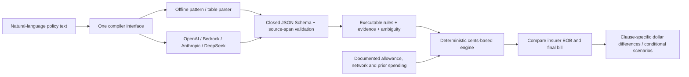

# Fineprint

[Live demo](https://raineymisty.github.io/Fineprint/)

**The fine print, finally on your side.** [中文](README_zh.md)

Fineprint helps **patients, caregivers and benefits advocates** check an insurer’s patient-responsibility calculation against the actual insurance contract, then reconcile the hospital bill. Built for **HackPrinceton Fall 2026 · Healthcare** and **Amazon Best Practical AI Innovation**.

**Policy text → evidence-linked executable rules → independent claim calculation → clause-specific dollar difference → final bill.** The insurer’s EOB is an observation to compare, never the answer Fineprint reuses. Arithmetic runs in a deterministic engine; an optional LLM compiles policy language, not dollar calculations.

**All bundled insurers, members, providers, policies, negotiated rates, EOBs and bills are synthetic/fictional. No real personal data.** The default demo, tests and evaluation run fully offline, without keys or runtime dependencies. Real DeepSeek API measurements on this synthetic benchmark are reported below.

## Run locally

Requires **Python 3.11+**. No installation is needed from this checkout:

```bash
python3 -m unittest discover -s tests -v
python3 -m fineprint.eval --provider fallback
python3 -m fineprint.server --port 8765
```

Open **http://127.0.0.1:8765**. Stop with Ctrl+C. Optional installation: `python3 -m pip install -e .`, then `fineprint`. Installation may download build tooling; running from source does not.

**95 tests pass**, covering strict schemas, source-span integrity, retries/provider request contracts with test doubles, synthetic fixtures, calculation independence, evaluation denominators and HTTP integration. DeepSeek was also evaluated with real API calls; other live providers remain unverified. Optional Chrome verification, using Node.js 22+ and Chrome without npm packages:

```bash
node scripts/browser_smoke.mjs
# Optional: CHROME_BIN=/path/to/chrome PYTHON_BIN=python3
```

The browser check exercises prose upload/recompilation, clickable source spans, unsupported-wording blocking, metrics, all three demo cases, scenarios, fact edits, JSON roundtrip, keyboard/mobile layout and absence of external requests. Screenshots go to ignored `artifacts/browser/`.

## A judge-ready hero case

1. Select **A deductible charged twice** (Aurora). The Policy step compiles the original SBC-style prose/table, showing **fallback · offline, no LLM**. Expand the editor to paste or upload `.txt`/`.md`, then compile. Matching policy/member IDs are required to analyze the selected EOB.
2. Inspect compiled deductible, OOP and benefit rules. Click a clause, then **Read quote** to highlight the exact source text. Each rule includes document ID, section, verbatim quote, Unicode character span, confidence and ambiguity. Export rules with their source/evidence separately from normalized case JSON.
3. Open **Claim**: insurer **$465**, Fineprint **$385**. Office visit: **$25**. MRI: **$200 remaining deductible + 20% × $800 = $360**. Clause **D-in** sets the annual deductible at $1,000; documented prior deductible spending is $800. The EOB instead applied $300 deductible and $140 coinsurance, assigning **$80 too much** on this line.
4. Open **Bill**: the hospital assigns **$505**, including another **$40 bill/EOB difference**. Fineprint flags **“You may be overpaying $120.”** With $100 already paid, its supported remaining amount is **$285**. All figures are synthetic case results, not real savings measurements.
5. Try Mosaic’s OOP case (**$150 difference**) or therapy ambiguity (**32 conditional scenarios**, illustrated totals **$0–$300**). Confirm network, allowance and prior spending to reduce therapy to two policy interpretations. Missing-fact endpoints do not exhaust possible outcomes; the lowest scenario is not a confirmed amount owed.

The static site's Evaluation screen compares the offline benchmark with saved DeepSeek measurements, including held-out failures. CI reads the committed LLM reports without API calls or keys. Case JSON import/export and fact edits remain in memory. Imported structured JSON has no compiler provenance unless the original policy text is compiled again. A favorable result is a documented question to review, not guaranteed savings or an instruction to withhold payment.

## Policy-to-Rules Compiler



`get_compiler().compile(text, document_id)` returns a policy plus evidence for every network financial rule and benefit rule. All providers share the same closed JSON Schema. Validation rejects missing/unknown fields, wrong types, floats/bools used as integer money, invalid dates/ranges, fabricated source spans, missing evidence and unmarked overlaps. Evidence quotes must equal the exact original `text[start:end]`; document SHA-256 identifies the source version. Schema/span validity does **not** prove the extracted interpretation is correct.

The **fallback is an actual deterministic natural-language parser**, not mocked model output or a lookup of gold JSON. It supports clause grids, numbered narrative sections and tagged paragraphs using bounded English cost-sharing patterns, explicit CPT/HCPCS codes, plan metadata and calculation-order language. It retains overlapping benefits as alternatives. Recognized clauses with unsupported wording remain unresolved and block calculation; missing core terms fail compilation. Arbitrary layouts, prose outside recognized clause blocks, complex exceptions and PDF/OCR are not reliably understood. The default demo does not read curated gold policy JSON; a regression test deletes that file and still runs the audit.

Confidence is an uncalibrated coverage/self-assessment field, not measured correctness probability. Conflicting clauses retain ambiguity instead of silently choosing the cheapest interpretation.

```bash
python3 -m fineprint.compiler fineprint/samples/aurora-imaging/policy.md \
  --provider fallback > compiled-policy.json
```

## Optional live providers

Set environment variables before starting the server/compiler/evaluation. Default: `FINEPRINT_LLM_PROVIDER=fallback`. There is **no automatic switch to an LLM when a key exists**, and no silent fallback when a selected provider fails.

| Provider | Configuration | Transport |
| --- | --- | --- |
| `openai` | `OPENAI_API_KEY`; optional `FINEPRINT_LLM_MODEL` | HTTPS Chat Completions with strict JSON-schema output. |
| `anthropic` | `ANTHROPIC_API_KEY`; optional `FINEPRINT_LLM_MODEL` | HTTPS Messages with JSON-schema output. |
| `deepseek` | `DEEPSEEK_API_KEY`; `FINEPRINT_DEEPSEEK_MODEL` defaults to `deepseek-v4-pro`; also `deepseek-flash` | Standard-library HTTPS to `https://api.deepseek.com/chat/completions`, JSON output mode, then the shared strict schema/evidence validation. |
| `bedrock` | `FINEPRINT_LLM_MODEL` = enabled model/inference profile; `AWS_REGION` or `AWS_DEFAULT_REGION`; usual AWS credential chain | Amazon Bedrock Converse with a forced schema-described tool; local strict validation. Requires a model supporting forced tools. |

Bedrock’s optional SDK: `python3 -m pip install -e '.[bedrock]'`. OpenAI, Anthropic and DeepSeek use standard-library HTTPS. `FINEPRINT_LLM_ATTEMPTS` defaults to 3 (allowed 1–5), with bounded backoff, transport timeouts and schema/source validation on every attempt. DeepSeek uses a 60-second timeout, 16,384 output tokens and thinking disabled; its model setting is independent of `FINEPRINT_LLM_MODEL`. Credentials and provider response bodies are excluded from errors. [.env.example](.env.example) documents variables; `.env` files are not loaded automatically. Never commit keys.

```bash
export FINEPRINT_LLM_PROVIDER=deepseek
# Set DEEPSEEK_API_KEY securely in your environment.
python3 -m fineprint.compiler fineprint/samples/aurora-imaging/policy.md
python3 -m fineprint.eval --provider deepseek --report-name evaluation-deepseek-v4-pro
FINEPRINT_DEEPSEEK_MODEL=deepseek-flash python3 -m fineprint.eval \
  --provider deepseek --report-name evaluation-deepseek-flash
# Explicitly use fallback for the offline benchmark regardless of server settings:
python3 -m fineprint.eval --provider fallback
```

A live provider receives submitted policy text; only choose one intentionally. DeepSeek measurements below come from real authenticated API calls. Provider test doubles are confined to tests and never counted as LLM evaluation results. Bedrock is the implemented Amazon integration path, not a claimed measured deployment.

## Measured evaluation — synthetic data

Run `python3 -m fineprint.eval` (default environment) or explicitly `python3 -m fineprint.eval --provider fallback`. It compiles text, substitutes only the compiled policy into each case, calculates every scenario, compares the EOB and reconciles the final bill. It writes [JSON results](reports/evaluation.json) and a [Markdown report](reports/evaluation.md); use `--output-dir PATH` to choose a directory. Reports identify backend, model, timestamp, revision and corpus/parser hashes.

### Offline fallback

The following numbers were **actually produced by the offline fallback** on **5 synthetic policy documents / 10 cases / 4 fictional insurers**:

| Split | Policies / cases | Extraction precision / recall | Exact calculation | Discrepancy precision / recall | False positive rate | Traceability / evidence coverage | End-to-end |
| --- | --- | --- | --- | --- | --- | --- | --- |
| Seen | 3 / 6 | 100.0% / 100.0% | 6/6 (100.0%) | 100.0% / 100.0% | 0.0% | 100.0% / 100.0% | 6/6 (100.0%) |
| Held-out | 2 / 4 | 100.0% / 56.8% | 2/4 (50.0%) | 100.0% / 50.0% | 0.0% | 100.0% / 52.9% | 2/4 (50.0%) |
| All | 5 / 10 | 100.0% / 84.8% | 8/10 (80.0%) | 100.0% / 83.3% | 0.0% | 100.0% / 81.8% | 8/10 (80.0%) |

**Fallback held-out protocol:** compiler freeze commit `bd9f7ab` precedes creation of **Cedar Assurance** (tagged reference cards) and **Harbor Benefits Cooperative** (transposed SBC matrix). A hash check confirms the parser is unchanged. Cedar parses; Harbor fails to establish network terms and both Harbor cases remain blocked. This is an **author-created format holdout, not a blinded external benchmark**. The author knows the grammar. No parser tuning used these held-out results. See [protocol](docs/benchmark-protocol.md).

Fallback metric details:

- **Extraction:** micro field precision/recall against separately authored gold; 89 correct fields, 0 spurious, 16 missing. Each policy scored once. Score network deductible/OOP/balance billing and per-code/network coverage, deductible applicability, copay, coinsurance and ambiguity. Cosmetic IDs, labels and ordering are ignored.
- **Calculation:** exact integer-cent match for all nine monetary fields on every line, networks, the complete distinct scenario-outcome set, scenario count and conditional status. Equal patient totals cannot hide incorrect components.
- **Discrepancy:** any EOB-versus-Fineprint patient-total difference per line in a nonconditional case. Five true positives, zero false positives, one false negative; two resolved true negatives. Therapy correctly abstains. A failed positive counts as a false negative; Harbor’s correct case is an abstention, not a true negative. FPR is 0/3 gold-negative cases, only two of which were resolved.
- **Evidence:** 36/36 emitted rules have valid source spans (**100%**); including eight missing Harbor rules, coverage is 36/44 (**81.8%**).
- **End-to-end:** exact extraction, exact claim and final bill reconciliation, complete evidence, and correct discrepancy decision or justified ambiguity abstention. Failed compilations remain in denominators.

Gold fixtures cover duplicate deductible, wrong network tier, preventive-care charges, ignored OOP cap, coinsurance on a copay benefit, correct adjudications and ambiguous/missing facts. These small synthetic results do not establish real-world accuracy, financial savings, or LLM quality. Rebuild authored data with `python3 scripts/generate_samples.py` and `python3 scripts/generate_benchmark.py`; neither generator imports the calculation engine or compiler. New parser development requires a new untouched holdout, not retuning against Harbor while keeping its held-out label.

### Real DeepSeek API measurements — synthetic data

Same benchmark: **5 synthetic policies / 10 cases, UTC 2026-11-15**. The existing shared prompt was unchanged: **no prompt tuning on seen or held-out insurers**. Retries used local validation errors only. Thinking disabled, JSON mode, 16,384 output tokens, 60-second timeout, up to 3 attempts per policy.

| Model | UTC date | Split | Extraction P / R | Exact calculation | End-to-end | Failed policies |
| --- | --- | --- | --- | --- | --- | --- |
| `deepseek-v4-pro` | 2026-11-15 | Seen | n/a / 0.0% | 0/6 (0.0%) | 0/6 (0.0%) | 3/3 |
| `deepseek-v4-pro` | 2026-11-15 | Held-out | n/a / 0.0% | 0/4 (0.0%) | 0/4 (0.0%) | 2/2 |
| `deepseek-v4-pro` | 2026-11-15 | All | n/a / 0.0% | 0/10 (0.0%) | 0/10 (0.0%) | 5/5 |
| `deepseek-flash` | 2026-11-15 | Seen | n/a / 0.0% | 0/6 (0.0%) | 0/6 (0.0%) | 3/3 |
| `deepseek-flash` | 2026-11-15 | Held-out | n/a / 0.0% | 0/4 (0.0%) | 0/4 (0.0%) | 2/2 |
| `deepseek-flash` | 2026-11-15 | All | n/a / 0.0% | 0/10 (0.0%) | 0/10 (0.0%) | 5/5 |

Neither model produced a validated policy: evidence coverage **0/44 (0%)**, traceability **n/a (0/0)**, and **10/10 case abstentions** per model. Discrepancy recall was **0/6 (0%)**, precision n/a; FPR was 0/3 with no resolved decisions, not successful detection. Failures remain in denominators; neither gold rules nor fallback results were substituted.

Final errors: v4-pro had four incomplete rule-evidence mappings and one source-span mismatch; flash had three span mismatches, one transport/timeout failure and one malformed JSON response.

Reports: [v4-pro JSON](reports/evaluation-deepseek-v4-pro.json) / [Markdown](reports/evaluation-deepseek-v4-pro.md); [flash JSON](reports/evaluation-deepseek-flash.json) / [Markdown](reports/evaluation-deepseek-flash.md). The committed offline fallback measurement above is dated **2026-11-14**.

## Calculation contract and API

Money is integer **USD cents**, member coinsurance is integer **basis points**. Supported order: **deductible → copay → coinsurance on remaining allowance → OOP cap**, with half-up cent rounding. Actual covered sharing updates separate annual individual in/out-network pools; full-charge exclusions and permitted balance bills stay outside the cap. Lines run by service date/ID, one visit/unit per line. Unknown coverage blocks. Above 256 scenarios blocks without truncation.

Allowed amounts, verified participation and pre-claim spending are separate evidence. An EOB-derived allowance makes the result a **conditional cost-sharing audit**, not independent verification of the negotiated rate. Missing-fact endpoints and favorable scenarios are never promoted to confirmed liability. Family pools, multiple claims/reversals, benefit limits, clinical/authorization decisions and legal billing protections are not implemented.

| API | Purpose |
| --- | --- |
| `GET /api/cases`, `GET /api/cases/{id}` | Three guided synthetic cases; case details compile original prose. |
| `POST /api/compile` | `{document, document_id?}` → compilation; add `case` to recalculate against that EOB/bill. |
| `POST /api/analyze` | Analyze normalized schema-v1.0 case JSON; structured imports carry no inferred compiler provenance. |
| `GET /api/evaluation` | Run the offline fallback benchmark, regardless of live-provider configuration. |

HTTP 400 reports structural/compilation errors. HTTP 200 with `report.status="blocked"` and no calculations reports semantic/unresolved-policy errors. JSON bodies are limited to 1 MiB. The server binds to loopback, stores no uploads and has no authentication or durable case storage. Production handling of real health information needs additional infrastructure.

## Code and next steps

| Location | Purpose |
| --- | --- |
| `compiler.py`, `providers.py` | Prose parser, shared schema/span validation and opt-in LLM transports. |
| `models.py`, `validation.py` | Strict case schema and cross-document checks. |
| `engine.py`, `comparison.py`, `service.py` | Independent arithmetic, reconciliation and analysis boundary. |
| `eval.py`, `benchmark/`, `samples/` | Measured evaluation, independent gold and fictional source documents. |
| `server.py`, `static/` | Local API and guided offline UI. |
| `tests/`, `scripts/`, `docs/` | Verification, fixture authoring, browser checks and architecture. |

Paths above are under `fineprint/` unless otherwise stated. See [architecture](docs/architecture.md) and [future public-data collection](docs/data-sources.md).

Remaining priorities: verify the other live providers; a broader parser/LLM evaluation on a **new** untouched holdout; PDF/OCR and varied SBC layouts; durable human review; consented de-identified real cases and verified rate/history evidence; family/shared pools and richer benefits. Existing Harbor failures remain documented. This round creates local commits only; the operator handles pushing. No deployment or git configuration changes.
