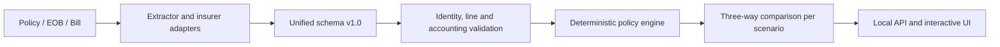

# Fineprint

**The fine print, finally on your side.** [中文](README_zh.md)

Fineprint connects **Policy → Claim (EOB) → Medical Bill** in one interactive case. It independently evaluates structured policy rules, compares its result with the insurer’s explanation of benefits and the hospital’s bill, and identifies amounts worth questioning with policy citations. A favorable scenario is a documented question to review, not a guarantee of savings or an instruction to withhold payment.

The foundation runs locally without API keys, third-party runtime packages, or external requests. **Every bundled person, insurer, provider, policy, claim, rate and bill is synthetic/fictional. There is no real personal data.** The UI is English; both READMEs cover the same content.

## Two phases

| Phase | Goal | Delivered here |
| --- | --- | --- |
| 1 — Connect documents | Make coverage, adjudication and payment understandable across insurers. | Versioned unified model, two insurer adapters, three complete document sets, cross-document validation, interactive UI, JSON import/export, tests. |
| 2 — Independently challenge calculations | Extract executable rules and recalculate the lowest reasonable patient responsibility supported by policy and evidence. | Working deterministic engine, three-way comparison, clause-linked explanations, ambiguity/missing-fact scenarios, pluggable extraction interface. Automated arbitrary prose/PDF extraction remains future work. |

Fineprint does not reuse insurer-calculated cost sharing as its own answer. Allowed amounts and pre-claim spending are required evidence. An EOB-derived allowance explicitly makes the result a **conditional cost-sharing audit**, rather than an independently verified rate calculation. The lowest illustrated scenario is never silently promoted to a confirmed amount owed.

## Install, test and launch

Requires **Python 3.11+**. From the repository root:

```bash
python3 -m venv .venv
source .venv/bin/activate
python -m pip install -e .
python -m unittest discover -s tests -v
fineprint
```

Open **http://127.0.0.1:8765**. Stop with Ctrl+C; use `fineprint --port 9000` to change ports. Installation may fetch build tooling; there are no runtime dependencies. A completely offline source checkout needs no installation:

```bash
python3 -m unittest discover -s tests -v
python3 -m fineprint.server --port 8765
```

The standard-library test suite has **56 passing tests**, including HTTP integration and manually worked fixture expectations. It needs no live model, account or network.

Optional browser verification requires Node.js 22+ and Chrome, without npm packages:

```bash
node scripts/browser_smoke.mjs
# Optional executable overrides: CHROME_BIN=/path/to/chrome PYTHON_BIN=python3
```

This starts/stops disposable server/browser processes and checks all cases, workflow tabs, clause links, scenarios, fact editing, JSON export/import, keyboard navigation, mobile layout, JavaScript errors and external requests. Screenshots go to ignored `artifacts/browser/`.

## Explore a case

1. Select a fictional case. **Policy** shows network terms, executable benefits and source clauses.
2. Open **Claim** and expand a service to compare recorded insurer components with Fineprint’s allowance, deductible, copay, coinsurance, exclusions, balance billing, insurer payment and write-off. Expand the calculation trace for clause citations and accumulator changes.
3. Choose a scenario when wording or facts are uncertain. Edit network status, documented allowance and pre-claim spending, then recalculate.
4. Open **Bill** to compare patient totals, previous payments, current balance due, Fineprint’s remaining amount and potential refunds. Follow discrepancies back to clauses.
5. Export normalized case JSON and import it again with **Open case JSON**. Semantic errors appear in validation and block calculation. Reset restores the selected/imported original. Imports and edits stay in memory; the app neither stores uploads nor sends documents to a model.

The local server binds to loopback by default. It is a development/demo server without authentication or persistent case storage. Production use and real health information require additional infrastructure.

## Synthetic cases

Identities, line links and accounting totals are internally consistent. Deliberate adjudication errors and bill/EOB differences demonstrate that balanced arithmetic does not prove policy compliance.

| Case | Source formats | Independent result | Comparison |
| --- | --- | --- | --- |
| Aurora: deductible charged twice | SBC-like grid, dollar EOB CSV, itemized bill CSV | Office $25 + MRI ($200 remaining deductible + 20% × $800) = **$385** | EOB $465; hospital total $505; **$120 potentially excessive**. $100 already paid; Fineprint remaining $285. |
| Mosaic: OOP limit matters | Narrative booklet, nested JSON EOB ledger, itemized bill CSV | Procedure capped at $50 + exclusion $300 + out-of-network transport $650 = **$1,000** | EOB and hospital $1,150; **$150 potentially excessive**. Exclusions and balance bills stay outside the cap. |
| Mosaic: therapy ambiguity | Conflicting narrative clauses, nested JSON EOB ledger, itemized bill CSV | **32 conditional scenarios**, illustrated patient totals $0–$300 | EOB and bill $40. Network, allowance and pre-claim spending are unknown. Endpoints do not exhaust possible outcomes. Supplying those facts leaves two policy interpretations. |

Each set includes a readable policy, curated policy JSON, source EOB, bill and manifest with links/rate evidence. Rebuild with `python3 scripts/generate_samples.py`; authored fixture numbers do not depend on the engine.

## Architecture and calculation contract



Python dataclasses and a strict decoder reject unknown/missing fields, float money, invalid dates and out-of-range values. Money is integer **USD cents**; member coinsurance is integer **basis points**. Documents preserve their own observations, linked by member/policy/claim IDs and explicit service-line links checked against provider/date/CPT or HCPCS code. Separate evidence supplies allowance and provenance.

Supported order: **deductible → copay → coinsurance on remaining allowance → OOP cap**. Coinsurance rounds half up to cents. Actual covered cost sharing updates the network’s OOP pool; the deductible portion also updates its deductible pool. Excess participating-provider charges are written off when terms prohibit balance billing. Permitted out-of-network balance bills and full-charge exclusions stay outside both pools. Lines run in service-date/line-ID order from pre-claim accumulators.

The contract supports individual annual, separate in/out pools and one visit/unit per line. Every code/network needs an explicit coverage or exclusion rule; unknown coverage blocks calculation. Conflicting rules require an explicit ambiguity group with a consistent interpretation across affected lines. Unknown network branches to both networks. Missing allowances/spending generate labeled illustrative endpoints. More than 256 scenarios blocks without silently dropping alternatives. Assumptions and EOB-derived allowances keep results conditional.

`PolicyExtractor` is a protocol. The working offline `StructuredPolicyExtractor` reads curated JSON and does **not** extract arbitrary prose/PDFs. `ProviderPolicyExtractor` accepts an injected callable for an LLM/document service and strictly checks output. It marks output as requiring source review; fixture ingestion refuses unreviewed provider output. After review, save verified clauses/rules as curated JSON. No SDK, API key or automatic external call is bundled.

| API | Purpose |
| --- | --- |
| `GET /api/cases` | List synthetic cases. |
| `GET /api/cases/{id}` | Normalized case, source documents, validation, links, scenarios and comparisons. |
| `POST /api/analyze` | Analyze schema-v1.0 case JSON in memory, up to 1 MiB. Structural errors return HTTP 400; semantic errors return HTTP 200 with `report.status = "blocked"` and no calculations. |

See [architecture and extension notes](docs/architecture.md) for boundaries, formulas, invariants and provider integration.

## Structure

```text
fineprint/
  models.py          # strict schema and integer money
  validation.py      # document consistency and links
  extraction.py      # offline and pluggable providers
  adapters.py        # fictional EOB formats and bill CSV
  engine.py          # rules, accumulators and scenarios
  comparison.py      # three-way comparison, refunds, citations
  service.py         # shared analysis/report boundary
  repository.py      # synthetic fixture loading
  server.py          # standard-library HTTP API
  static/            # responsive HTML/CSS/JavaScript UI
  samples/           # three fictional document sets
tests/               # models, validation, engine, providers, fixtures, HTTP
scripts/             # fixture generation and optional browser checks
docs/                # architecture, decisions and public data sources
```

## Public data to collect later

Checked **2026-11-14**; collection candidates, not bundled real data or matched patient cases:

- [CMS SBC template PDF](https://www.cms.gov/CCIIO/Resources/Forms-Reports-and-Other-Resources/Downloads/SBC-Template-Accessible-Format-01-2020.pdf): canonical summary fields and coverage examples.
- [UnitedHealthcare public SBC page and sample PDF](https://www.uhc.com/understanding-health-insurance/how-does-health-insurance-work/summary-of-benefits-and-coverage): real insurer presentation and public sample terms. Collect other insurers’ plan-year SBCs and complete policy documents too.
- [CMS Hospital Price Transparency](https://www.cms.gov/priorities/key-initiatives/hospital-price-transparency/hospitals): hospital standard-charge files, including payer-specific negotiated charges.
- [CMS Transparency in Coverage public-data guidance](https://www.cms.gov/initiatives/healthplan-price-transparency/overview/public-data): payer machine-readable rates and out-of-network allowed amounts.

SBCs and public price files are not a matched policy/EOB/bill trio and do not automatically establish a specific service’s rate. Separately collect permissioned, de-identified matched cases. Preserve URL, retrieval date, plan year, network, clause location and document version; retain ambiguity and held-out insurer examples. See [collection notes](docs/data-sources.md).

## Roadmap / TODO

- **Phase 1:** more insurer adapters, document ingestion, uncertain line matching, persistent reviewed cases and a larger cross-insurer benchmark. Current import is normalized JSON, not PDF/OCR.
- **Phase 2 extraction:** selected provider transport, PDF/OCR, clause span provenance, durable review/approval, extraction accuracy tests and rule migrations. No real LLM service is configured yet.
- **Phase 2 calculation:** family/embedded deductibles, shared/tiered pools, multiple claims/reversals, units/modifiers, benefit limits, authorization/medical necessity, coordination of benefits and applicable billing protections. This demo does not decide legal balance-billing liability or clinical coverage.
- **Evaluation/operation:** consented, de-identified, reviewed real cases; held-out insurer tests; verified rates/history; authentication, secure storage, access controls and production hosting before real health information handling.

This run creates local commits only. Nothing is pushed or deployed.
