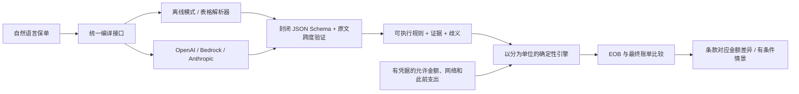

# Fineprint

[在线演示](https://raineymisty.github.io/Fineprint/)

**让保单细则，真正站在用户这一边。** [English](README.md)

Fineprint 面向 **患者、照护者及医保权益协助人员**：根据保险合同独立核算患者责任金额，与保险公司的 EOB 对比，再核对医院账单。项目参加 **HackPrinceton Fall 2026 · Healthcare** 和 **Amazon Best Practical AI Innovation** 赛道。

**自然语言保单 → 带原文证据的可执行规则 → 独立理赔核算 → 精确条款与金额差异 → 最终账单核对。** EOB 是待比较的观察值，不是 Fineprint 复用的答案。计算由确定性引擎完成；可选 LLM 用于编译保单语言，不负责金额运算。

**所有内置保险公司、会员、医疗机构、保单、协议价格、EOB 和账单均为合成／虚构数据，不含真实个人信息。** 默认演示、测试和评估完全离线，无需密钥或运行时依赖。尚无实际 LLM 服务的测量结果。

## 本地运行

需要 **Python 3.11+**，源码目录中无需安装：

```bash
python3 -m unittest discover -s tests -v
python3 -m fineprint.eval --provider fallback
python3 -m fineprint.server --port 8765
```

打开 **http://127.0.0.1:8765**，Ctrl+C 停止。可选安装：`python3 -m pip install -e .`，然后运行 `fineprint`。安装可能下载构建工具；直接运行源码无需下载。

**80 项测试通过**，涵盖严格模式验证、原文跨度、重试及服务请求契约（使用测试替身）、合成样例、计算独立性、评估分母和 HTTP 集成。实际在线服务调用尚未验证。可选浏览器检查需要 Node.js 22+ 和 Chrome，无需 npm 包：

```bash
node scripts/browser_smoke.mjs
# 可选：CHROME_BIN=/path/to/chrome PYTHON_BIN=python3
```

浏览器检查涵盖上传／重新编译保单、原文高亮、不支持措辞时阻止计算、指标、三个演示案例、情景与事实编辑、JSON 往返、键盘／移动布局以及无外部请求。截图位于忽略目录 `artifacts/browser/`。

## 核心演示流程

1. 选择 Aurora 的 **A deductible charged twice**。Policy 步骤直接编译 SBC 风格的原始自然语言／表格，标明 **fallback · offline, no LLM**。展开编辑器可粘贴或上传 `.txt`／`.md` 并重新编译。保单和会员标识必须与所选 EOB 匹配。
2. 查看编译出的免赔额、自付上限及保障规则。点击条款，再点 **Read quote**，即可在原文中高亮精确引用。每条规则包含文件 ID、章节、逐字引用、Unicode 字符跨度、置信度和歧义。规则及证据可单独导出；统一案例 JSON 另行导出。
3. 打开 **Claim**：保险公司计算 **$465**，Fineprint 计算 **$385**。门诊 **$25**；MRI 为 **剩余免赔额 $200 + 20% × $800 = $360**。条款 **D-in** 规定年度免赔额 $1,000，已有凭据显示此前满足 $800。EOB 却使用 $300 免赔额及 $140 共同保险，因此该项目多分配 **$80** 给患者。
4. 打开 **Bill**：医院患者总额为 **$505**，比 EOB 又多 **$40**。Fineprint 显示 **“You may be overpaying $120.”** 已付款 $100 后，支持的剩余金额是 **$285**。这些数字来自虚构案例核算，不是真实节省金额的测量。
5. 查看 Mosaic 的自付上限案例（**$150 差异**），以及治疗歧义案例（**32 个有条件情景**，演示总额 **$0–$300**）。补齐网络、允许金额和历史支出后，治疗案例仍有两个合同解释。缺失事实的端点并不穷尽可能结果，最低情景不是确认应付金额。

评估面板可运行离线基准并显示未见格式失败。案例导入和事实编辑保留在内存中。导入的结构化 JSON 不附带编译来源；需再次编译原文才能建立跨度证据。有利结果是有据可查的复核问题，不保证节省，也不构成停止付款的指示。

## Policy-to-Rules 编译器



`get_compiler().compile(text, document_id)` 返回保单规则，并为每项网络财务规则及保障规则附上证据。所有后端共享同一封闭 JSON Schema，拒绝缺失／未知字段、类型错误、浮点数或布尔值充当金额、无效日期／范围、伪造跨度、缺失证据和未标明的冲突。引用必须精确等于原文 `text[start:end]`；SHA-256 标识文件版本。结构和跨度正确不等于语义解释正确。

**fallback 是实际的确定性自然语言解析器**，不模拟模型输出，也不查找金标准 JSON。支持条款网格、编号叙述章节、带标签段落及有限的英语费用分担表达，需要明确的 CPT／HCPCS 编码、保单元信息和运算顺序条款。冲突规则保留为备选解释。已识别条款中的不支持措辞标记为 unresolved 并阻止计算，缺少核心条款则编译失败。任意版式、条款块之外的叙述、复杂例外及 PDF／OCR 尚不能可靠理解。默认演示不读取金标准保单 JSON；回归测试删除该文件后仍能完成核算。

置信度是未校准的解析覆盖／模型自评字段，不是经测量的正确概率。存在冲突时保留歧义，不自动选择最便宜的解释。

```bash
python3 -m fineprint.compiler fineprint/samples/aurora-imaging/policy.md \
  --provider fallback > compiled-policy.json
```

## 可选在线后端

启动服务器、编译器或评估前设置环境变量。默认 `FINEPRINT_LLM_PROVIDER=fallback`；存在密钥不会自动启用 LLM，选定后端失败也不会偷偷切回 fallback。

| 后端 | 配置 | 传输 |
| --- | --- | --- |
| `openai` | `OPENAI_API_KEY`；可选 `FINEPRINT_LLM_MODEL` | HTTPS Chat Completions，严格 JSON Schema 输出。 |
| `anthropic` | `ANTHROPIC_API_KEY`；可选 `FINEPRINT_LLM_MODEL` | HTTPS Messages，JSON Schema 输出。 |
| `bedrock` | `FINEPRINT_LLM_MODEL` 为已启用模型／推理配置 ID；`AWS_REGION` 或 `AWS_DEFAULT_REGION`；标准 AWS 凭据链 | Amazon Bedrock Converse，强制返回指定工具及规则结构，再本地严格验证。所选模型须支持强制工具。 |

Bedrock 可选 SDK：`python3 -m pip install -e '.[bedrock]'`。OpenAI 与 Anthropic 使用标准库 HTTPS。`FINEPRINT_LLM_ATTEMPTS` 默认 3，允许 1–5 次，具有有界退避、网络超时，每次尝试都校验结构和原文。错误信息不包含密钥和服务响应正文。[.env.example](.env.example) 列出变量；应用不会自动加载 `.env`。不要提交密钥。

```bash
export FINEPRINT_LLM_PROVIDER=openai
# 在环境中安全设置 OPENAI_API_KEY。
python3 -m fineprint.compiler fineprint/samples/aurora-imaging/policy.md
# 无论服务器如何配置，以下命令明确运行离线基准：
python3 -m fineprint.eval --provider fallback
```

在线后端会收到提交的保单文本，应明确选择后使用。集成代码及请求契约已实现，但**当前没有密钥，没有运行任何真实在线后端**。测试替身仅用于测试，不计为 LLM 评估结果。Bedrock 是已经实现的 Amazon 接入路径，不代表已完成部署或实测。

## 实测评估：合成数据上的离线 fallback

默认环境运行 `python3 -m fineprint.eval`，或明确指定 `python3 -m fineprint.eval --provider fallback`。流程编译原文，只用编译结果替换案例保单，计算全部情景，对比 EOB 并核对最终账单。生成 [JSON 结果](reports/evaluation.json) 和 [Markdown 报告](reports/evaluation.md)，可用 `--output-dir PATH` 指定目录。报告记录后端、模型、时间戳、提交版本及语料／解析器哈希。

下列数字**确实来自本次离线 fallback 执行**，覆盖 **5 份合成保单／10 个案例／4 家虚构保险公司**：

| 集合 | 保单／案例 | 提取精确率／召回率 | 金额完全正确 | 差异检测精确率／召回率 | 假阳性率 | 原文可追溯率／证据覆盖率 | 端到端 |
| --- | --- | --- | --- | --- | --- | --- | --- |
| 开发已见 | 3 / 6 | 100.0% / 100.0% | 6/6 (100.0%) | 100.0% / 100.0% | 0.0% | 100.0% / 100.0% | 6/6 (100.0%) |
| 留出未见 | 2 / 4 | 100.0% / 56.8% | 2/4 (50.0%) | 100.0% / 50.0% | 0.0% | 100.0% / 52.9% | 2/4 (50.0%) |
| 全部 | 5 / 10 | 100.0% / 84.8% | 8/10 (80.0%) | 100.0% / 83.3% | 0.0% | 100.0% / 81.8% | 8/10 (80.0%) |

**留出协议：** 先在提交 `bd9f7ab` 冻结编译器，再创建 **Cedar Assurance**（标签式参考卡）和 **Harbor Benefits Cooperative**（转置 SBC 矩阵）。哈希检查确认解析器未改动。Cedar 成功；Harbor 无法建立网络规则，两个案例均阻止计算。这是**作者编写的格式留出集，不是盲测或外部基准**；作者了解语法。没有使用这些结果调优解析器，详见 [协议](docs/benchmark-protocol.md)。

指标定义：

- **规则提取：** 对独立编写金标准计算微平均字段精确率／召回率：89 个正确、0 个多余、16 个缺失字段。每份保单仅统计一次。覆盖网络免赔额／自付上限／差额收费，以及每个编码／网络下的承保、免赔适用、共付额、共同保险及歧义；忽略展示 ID、标签及顺序。
- **独立计算：** 逐项目九个金额字段均精确到分，网络、完整的不同情景结果集合、情景数及有条件状态也须一致。患者总额相同不能掩盖项目计算错误。
- **差异检测：** 在无条件案例中，逐项目检查 EOB 与 Fineprint 患者总责任是否不同。5 个真阳性、0 个假阳性、1 个假阴性；2 个已确认真阴性。治疗歧义案例正确弃权。编译失败的正例计为假阴性；Harbor 的正确理赔案例为弃权，不算真阴性。假阳性率是 0/3 个金标准负例，其中仅 2 个得到明确结果。
- **证据：** 已输出 36/36 条规则有有效原文跨度（**100%**）；把 Harbor 缺失的 8 条规则计入后，覆盖率为 36/44（**81.8%**）。
- **端到端：** 须同时满足规则完全正确、理赔及最终账单核对完全正确、证据完整、差异判断正确或有合理歧义弃权。编译失败不从分母删除。

样例覆盖重复免赔额、错误网络费率、预防服务收费、忽略自付上限、共付服务额外收共同保险、正确理赔，以及歧义／缺失事实。这些小规模合成结果不能证明真实准确率、节省金额或 LLM 质量。可用 `python3 scripts/generate_samples.py` 和 `python3 scripts/generate_benchmark.py` 重建人工编写数据；两个生成器均不导入引擎或编译器。后续解析器开发需要新的未见留出集，不能用 Harbor 调优后继续称其未见。

## 计算约定与 API

金额为整数 **美元分**，共同保险为整数 **基点**。顺序为 **免赔额 → 共付额 → 剩余允许金额的共同保险 → 自付上限**，按四舍五入取整到分。实际承保自付更新个人年度、网络内／外独立累计池；全额不保费用和允许的差额收费在上限之外。每项目一次就诊／一个单位，按日期／项目 ID 处理。未知保障阻止计算，超过 256 个情景时整体阻止，不截断。

允许金额、已核实网络和此前支出须单独提供证据。允许金额来自 EOB 时，结果为**有条件费用分担核查**，不声称独立验证协议价格。缺失事实端点及有利情景不是确认责任。家庭累计池、多理赔／冲销、保障限额、临床／预授权及法律收费保护尚未实现。

| API | 用途 |
| --- | --- |
| `GET /api/cases`、`GET /api/cases/{id}` | 三个引导演示案例；详情读取并编译原文。 |
| `POST /api/compile` | `{document, document_id?}` 返回编译结果；附 `case` 则用该 EOB／账单重新核算。 |
| `POST /api/analyze` | 分析 schema-v1.0 案例 JSON；不凭空附加原文编译来源。 |
| `GET /api/evaluation` | 无论在线后端配置如何，运行离线 fallback 基准。 |

结构／编译错误返回 HTTP 400；语义或 unresolved 错误返回 HTTP 200、`report.status="blocked"`，不产生金额。JSON 请求上限 1 MiB。服务器仅监听回环地址，不保存上传，没有认证或持久化存储；真实健康信息处理需额外基础设施。

## 代码与后续工作

| 位置 | 职责 |
| --- | --- |
| `compiler.py`、`providers.py` | 原文解析、统一模式／跨度校验及可选在线后端。 |
| `models.py`、`validation.py` | 严格案例模型及跨文件验证。 |
| `engine.py`、`comparison.py`、`service.py` | 独立运算、账单核对及分析接口。 |
| `eval.py`、`benchmark/`、`samples/` | 实测评估、独立金标准和虚构原始文件。 |
| `server.py`、`static/` | 本地 API 与离线引导 UI。 |
| `tests/`、`scripts/`、`docs/` | 验证、样例编写、浏览器检查及架构。 |

除另行说明外，上述实现文件位于 `fineprint/` 下。参见 [架构](docs/architecture.md) 和 [后续公共数据采集](docs/data-sources.md)。

下一步：真实凭据下验证在线后端；在**新的**未见集合上评估更广泛解析器／LLM；PDF／OCR 和更多 SBC 格式；持久化人工审核；经同意、去标识化的真实案例及已核实协议价格／历史支出；家庭／共享池与复杂保障。Harbor 的失败继续保留。本轮仅创建本地提交，由操作方负责推送；未部署、未修改 git 配置。
